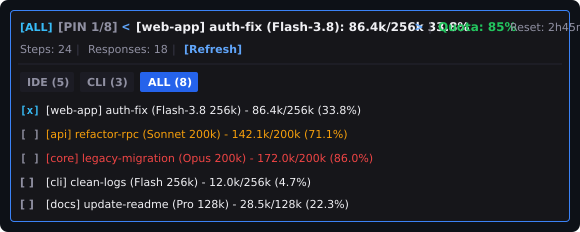

# agy-floating-widget

<p align="center">
  <strong>Lightweight Desktop Floating Widget for Google Antigravity (IDE & CLI)</strong><br>
  Real-time Quota Tracking • Context Window Monitoring • Multi-Session Drawer & Carousel • Zero Heavy Dependencies
</p>

<p align="center">
  <a href="https://github.com/zhangkuo-kuo/agy-floating-widget/blob/main/LICENSE"></a>
  
  
  <a href="https://github.com/zhangkuo-kuo/agy-floating-widget/stargazers"></a>
  <a href="https://github.com/zhangkuo-kuo/agy-floating-widget/issues"></a>
</p>

<p align="center">
  <a href="#english">English</a> • <a href="#中文说明">中文说明</a>
</p>

---

## English

`agy-floating-widget` is a standalone, always-on-top desktop floating capsule designed for developers using **Google Antigravity** (both Antigravity IDE and `antigravity-cli`). It monitors your active model quota percentage, reset countdown, and per-session context token usage in real time, without burning LLM tokens or cluttering your editor status bar.

### UI Preview

<p align="center">
  
</p>

### Highlights & Why Use This?

- ⚡ **Zero-Overhead & Lightweight**: Built with standard library `tkinter`, launching in milliseconds with ~25MB RAM usage. No Electron, no Node.js runtime, no browser needed.
- 🔄 **IDE + CLI Unified Hub**: Automatically detects local Antigravity `language_server` on `127.0.0.1` and parses local transcripts (`~/.gemini/antigravity/brain` and `~/.gemini/antigravity-cli/brain`).
- 🧠 **Dynamic Model Detection**: Discovers model IDs and token limits dynamically from local RPC and session metadata (Gemini 3.x, Gemini 4, Claude Sonnet/Opus, GPT-OSS, etc.).
- 📌 **Session Pinning & Renaming**: Pin your critical sessions to the carousel and assign readable nicknames via right-click menu.
- 🛡️ **Cross-Platform**:
  - **Windows**: High-DPI awareness, Win32 `HWND_TOPMOST` persistence, silent PowerShell discovery fallback.
  - **Linux**: Clean X11/Wayland font fallback, `<Button-4>/<Button-5>` scroll wheel events, `/proc` + `ss`/`lsof` socket inspection.

### Quick Start

#### Requirements
- Python 3.9+ with `tkinter`
  - Linux (Ubuntu/Debian): `sudo apt install python3-tk`
  - Windows: Included with standard Python.
- *(Optional)* `psutil` for microsecond socket lookup: `pip install -e ".[fast]"`

#### Installation & Launch
```bash
# One-line install from GitHub
pip install git+https://github.com/zhangkuo-kuo/agy-floating-widget.git

# Or clone for local development
git clone https://github.com/zhangkuo-kuo/agy-floating-widget.git
cd agy-floating-widget
pip install -e .

# Launch command
agy-widget

# Windows silent background launch (no terminal window)
agy-widget-gui
# or
pythonw -m agy_floating_widget
```

### Interactive Gestures & Shortcuts

| Action | Target | Behavior |
| :--- | :--- | :--- |
| **Drag** | Capsule body | Move floating capsule across screens |
| **Double Click** | Capsule body | Toggle expandable session drawer |
| **Mouse Wheel** | Capsule body | Cycle next / previous active session |
| **Click `[ALL]/[IDE]/[CLI]`** | Category label | Filter sessions between IDE, CLI, or all |
| **Right Click** | Capsule or Refresh | Context menu (Pin, Rename, Filter short CLI, Reset pos, Exit) |

---

## 中文说明

`agy-floating-widget` 专为 **Google Antigravity**（IDE 与 CLI）深度使用者打造的轻量桌面置顶悬浮窗。无需启动笨重的扩展或网页，实时在桌面显示当前账号配额剩余、重置倒计时与每个会话的上下文窗口（Token）占用率。

### 为什么选择它？

- 🚀 **极度轻量，零强制外部依赖**：基于 Python 标准库 `tkinter` 开发，内存占用仅约 20~30MB，秒开即用。
- 🔗 **IDE 与 CLI 双向打通**：同时探测本地 `language_server`（`127.0.0.1`）RPC 接口与本地磁盘日志，自动聚合 Antigravity IDE 与命令行 `antigravity-cli` 的会话。
- 🎯 **自动适配任意模型**：动态提取最新模型配额与上限（支持 Gemini 3.x/4 系列、Claude Sonnet/Opus、本地模型等），彻底告别手动维护模型配置。
- 📌 **会话管理**：支持右键为长会话命名别名、Pin 钉住核心会话、过滤仅有几步的短命 CLI 会话。
- 💻 **深度双系统适配**：
  - Windows：高分屏 DPI 缩放补偿、`HWND_TOPMOST` 防遮挡保活、PowerShell 自动探测。
  - Linux：适配字体平替、Linux 滚轮事件兼容、`/proc` 与 `ss`/`lsof` 端口探测。

### 交互操作速查

- **鼠标拖拽**：按住胶囊主体任意位置可随意拖拽，多显示器自由停靠。
- **双击胶囊**：快速展开/折叠下方详细的滚动会话抽屉。
- **滚轮滚动**：在胶囊上滚动滚轮直接切换前一个/后一个会话；在抽屉内滚动平滑查看历史会话。
- **点击分类标签**：在 `[ALL]`、`[IDE]`、`[CLI]` 之间快速过滤。
- **右键菜单**：提供立即刷新、钉住会话、自定义重命名、过滤短会话、复位屏幕中央及退出。

### 配置文件说明

运行状态保存在用户目录 `~/.gemini/agy-floating-widget/` 下（如 `widget_config.json`），绝不污染项目目录与全局环境。

```json
{
  "filter_short_cli": true,
  "min_cli_steps": 10,
  "cli_active_grace_min": 15,
  "current_category": "ALL"
}
```

## Contributing

Pull Requests and Issues are warmly welcomed! Please feel free to suggest features or submit fixes.

## License

This project is licensed under the [MIT License](LICENSE).
